# dev-workspace

개발 워크스테이션 구축 과제 1 — WSL2 + Ubuntu + Docker 개발환경 구축

## 1. 환경 정보

| 항목 | 버전 |
|------|------|
| WSL | 3.0.3.0 (WSL2) |
| Ubuntu | 26.04.1 LTS |
| Docker | 29.9.2 (build a82e528) |

## 2. 저장소 구조

```
dev-workspace/
├── README.md
├── get-docker.sh        # Docker 공식 설치 스크립트
├── docker-env/
│   └── Dockerfile       # ubuntu:latest 기반 개발용 이미지
└── images/              # 실행 결과 스크린샷
```

구성 기준: 이미지 빌드에 필요한 파일은 `docker-env/`에 모아 빌드 컨텍스트를 작게 유지하고(불필요한 파일이 이미지 빌드에 전송되지 않음), 문서용 증거 자료는 `images/`로 분리했다.

## 3. 설치 및 실행 과정

### 3-1. Docker 설치 확인

```bash
docker --version
```

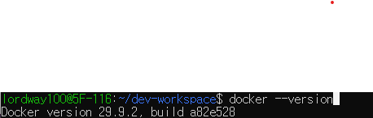

`docker --version`은 클라이언트(CLI) 버전만 보여주므로, 데몬(서버)이 실제로 동작하는지는 `docker info`로 확인했다.

```bash
docker info
```

`Server:` 항목에 서버 버전(29.9.2), 컨테이너·이미지 수, 스토리지 드라이버(overlayfs), Cgroup 드라이버(systemd) 정보가 출력되어 데몬이 정상 실행 중임을 확인했다. 데몬이 꺼져 있으면 `Cannot connect to the Docker daemon` 에러가 출력된다.

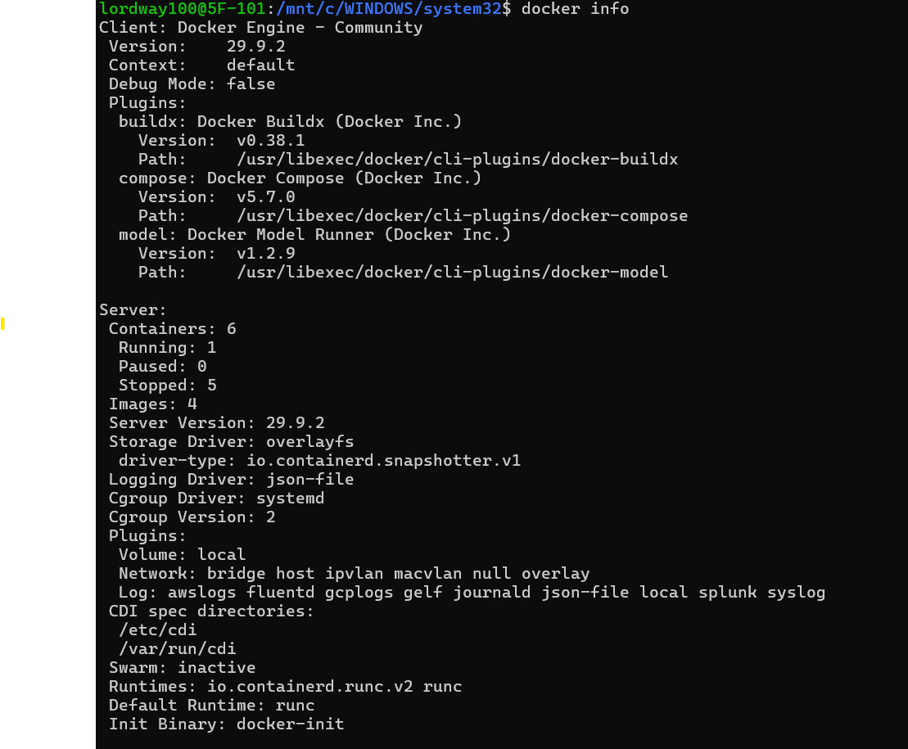

### 3-2. hello-world 컨테이너 실행

```bash
docker run hello-world
```

Docker 클라이언트가 데몬에 요청 → Docker Hub에서 이미지 pull → 컨테이너 생성 및 실행 → 출력 전달 순서로 동작함을 확인했다.

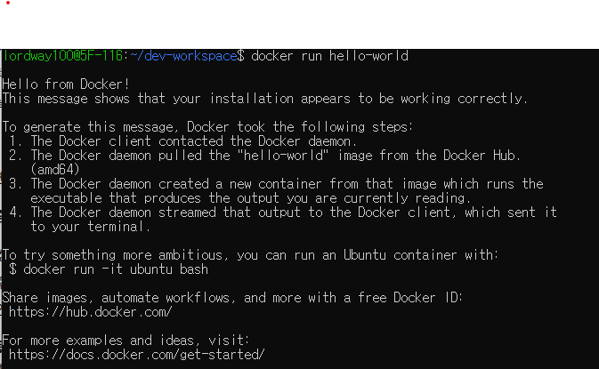

### 3-3. ubuntu 컨테이너 실행

```bash
docker run -it ubuntu bash
cat /etc/os-release
exit
```

`-i`(입력 유지)와 `-t`(터미널 할당)로 컨테이너 안의 bash에 접속했다. 컨테이너 내부 OS가 Ubuntu 26.04.1 LTS임을 확인했다.

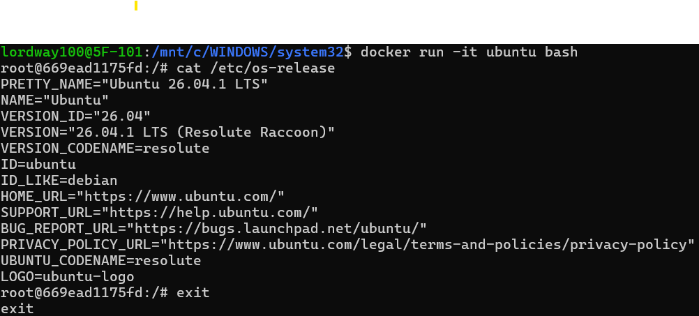

### 3-4. 컨테이너 목록 확인

```bash
docker ps -a
```

`-a` 옵션은 종료된(Exited) 컨테이너까지 모두 보여준다. hello-world, ubuntu, my-ubuntu 컨테이너가 실행 후 정상 종료(Exited (0))된 것을 확인할 수 있다.

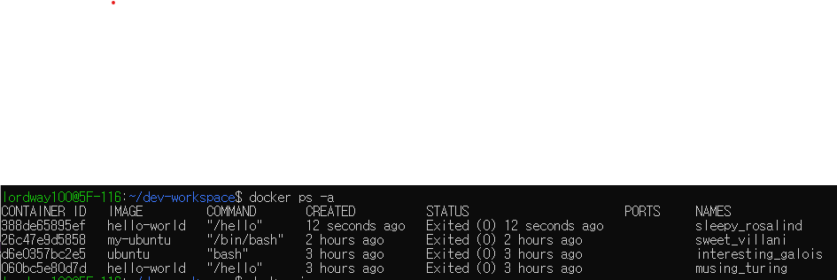

### 3-5. 이미지 목록 확인

```bash
docker images
```

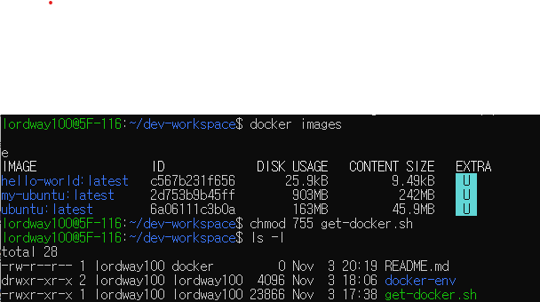

### 3-6. 파일 권한 설정

```bash
chmod 755 get-docker.sh
ls -l
```

권한은 소유자(user) / 그룹(group) / 기타(other) 세 자리로 표시하며, 각 자리는 아래 값의 합이다.

| 기호 | 의미 | 숫자 |
|------|------|------|
| `r` | 읽기 | 4 |
| `w` | 쓰기 | 2 |
| `x` | 실행 (디렉터리는 진입) | 1 |

| 숫자 | 기호 | 용도 예시 |
|------|------|-----------|
| `755` | `rwxr-xr-x` | 실행 스크립트, 디렉터리 |
| `644` | `rw-r--r--` | 일반 파일 (README 등) |
| `600` | `rw-------` | 비밀 키 등 본인만 읽는 파일 |

`get-docker.sh`는 직접 실행해야 하므로 `755`를 주었다. 실행 후 권한이 `-rwxr-xr-x`로 바뀌고 파일명이 실행 파일 색(초록)으로 표시되는 것을 확인했다.

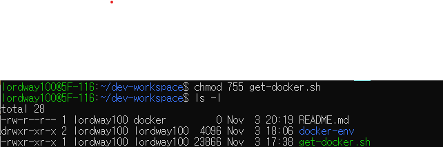

### 3-7. Dockerfile 작성

`docker-env/Dockerfile`

```dockerfile
FROM ubuntu:latest

RUN apt-get update && apt-get install -y \
    python3 \
    python3-pip \
    git \
    curl

WORKDIR /app

CMD ["/bin/bash"]
```

### 3-8. 이미지 빌드

```bash
docker build -t my-ubuntu ./docker-env
```

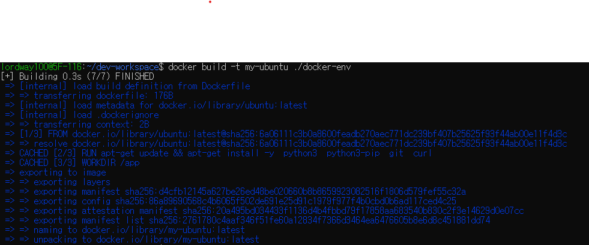

### 3-9. 포트 매핑 및 접속 테스트

`my-ubuntu`에는 웹 서버가 없으므로 nginx 이미지로 테스트한다.

```bash
docker run -d -p 8080:80 --name web nginx
curl http://localhost:8080
```

`-d`는 백그라운드 실행, `-p 8080:80`은 호스트 8080 포트를 컨테이너 80 포트에 연결한다. 로컬에 nginx 이미지가 없어 Docker Hub에서 자동으로 pull한 뒤 실행되었다.

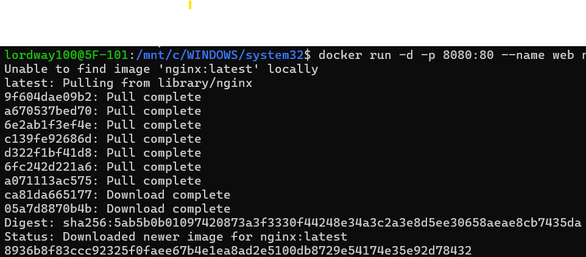

호스트에서 `localhost:8080`으로 요청하자 컨테이너의 nginx가 응답(`Welcome to nginx!`)하여 포트 매핑이 정상 동작함을 확인했다.

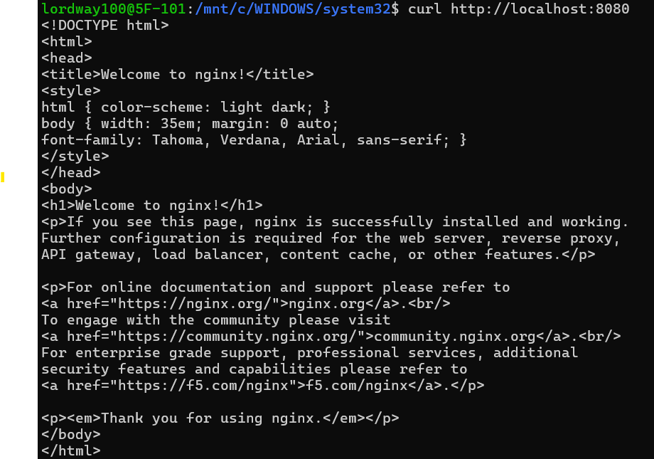

### 3-10. GitHub 연동

```bash
git remote -v
git log --oneline -5
```

`origin`이 GitHub 저장소(`lordway100/dev-workspace`)로 fetch·push 모두 연결되어 있고, 로컬 `main`이 `origin/main`과 같은 커밋을 가리켜 작업 내역이 GitHub에 push되었음을 확인했다. 교육장 PC와 집 PC 등 여러 환경에서 `git clone` → 작업 → `push` 흐름으로 이어서 작업했다.

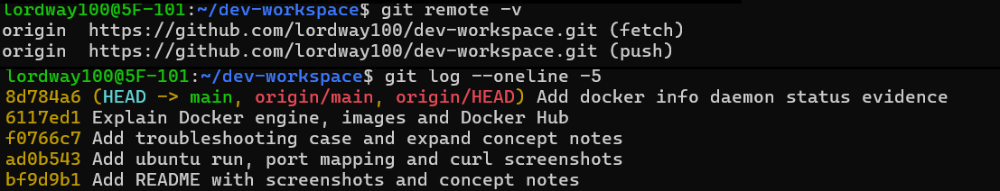

## 4. 개념 정리

### WSL2
Windows Subsystem for Linux 2. Windows 안에서 경량 가상머신으로 실제 Linux 커널을 실행해, 별도 VM 설치 없이 Linux 환경을 쓸 수 있게 해준다. WSL1보다 파일 시스템 성능과 시스템 호출 호환성이 좋아 Docker 실행이 가능하다.

### Docker
애플리케이션과 실행에 필요한 라이브러리·설정을 하나의 이미지로 묶어, 어느 환경에서든 같은 방식으로 실행할 수 있게 해주는 컨테이너 플랫폼이다. "내 PC에선 되는데" 문제를 줄여준다.

- **Docker 엔진**: 이미지를 받아 컨테이너로 실행해 주는 실행기. 그 자체로는 아무 애플리케이션도 들어 있지 않다.
- **이미지**: OS 파일·프로그램·라이브러리·설정을 통째로 묶은 패키지. 실제로 실행되는 내용물이다.
- **Docker Hub**: 이미지를 공유하는 공개 저장소(레지스트리). `docker run nginx`를 실행했을 때 로컬에 이미지가 없으면 Docker Hub에서 자동으로 내려받는다(pull). 한 번 받은 이미지는 로컬에 저장되어 다음부터는 바로 실행된다.

```
Unable to find image 'nginx:latest' locally   ← 로컬에 없음
latest: Pulling from library/nginx            ← Docker Hub에서 다운로드
Status: Downloaded newer image for nginx:latest
```

일관성은 이미지에서 나온다. 같은 이미지를 받으면 어느 PC에서든 내부 파일이 동일하므로 같은 환경이 재현된다. 이 과제의 `my-ubuntu`는 Docker Hub의 `ubuntu` 이미지 위에 python3·git·curl을 설치해 **직접 만든** 이미지로, Dockerfile만 있으면 다른 PC에서도 `docker build`로 같은 이미지를 다시 만들 수 있다.

### 컨테이너 vs 가상머신

| 구분 | 컨테이너 | 가상머신 |
|------|----------|----------|
| 격리 단위 | 프로세스 (호스트 커널 공유) | OS 전체 (게스트 OS 포함) |
| 크기 | MB 단위 | GB 단위 |
| 시작 시간 | 초 단위 | 분 단위 |
| 자원 사용 | 가벼움 | 무거움 |
| 격리 수준 | 상대적으로 약함 | 강함 |

### 이미지 vs 컨테이너
- **이미지**: 실행에 필요한 파일과 설정을 담은 읽기 전용 템플릿 (클래스에 비유)
- **컨테이너**: 이미지를 실행한 인스턴스. 하나의 이미지로 여러 컨테이너를 만들 수 있다 (객체에 비유)

| 단계 | 명령 | 결과 |
|------|------|------|
| 빌드 | `docker build` | Dockerfile → 이미지 생성 (변경 불가 레이어) |
| 실행 | `docker run` | 이미지 위에 쓰기 가능한 레이어를 얹어 컨테이너 생성 |
| 변경 | 컨테이너 안에서 파일 수정 | 그 컨테이너의 쓰기 레이어에만 기록, **이미지는 그대로** |
| 삭제 | `docker rm` | 쓰기 레이어(변경 내용)도 함께 사라짐 |

그래서 변경 사항을 남기려면 Dockerfile을 고쳐 다시 빌드하거나, 데이터는 볼륨에 저장해야 한다.

### Dockerfile 주요 문법

| 명령 | 의미 |
|------|------|
| `FROM` | 기반 이미지 지정 |
| `RUN` | 빌드 시 실행할 명령 (패키지 설치 등) |
| `WORKDIR` | 이후 명령의 작업 디렉터리 |
| `COPY` | 호스트 파일을 이미지로 복사 |
| `ENV` | 환경 변수 설정 |
| `EXPOSE` | 컨테이너가 사용하는 포트 명시 |
| `CMD` | 컨테이너 시작 시 기본 실행 명령 |

### 포트 매핑
`-p 호스트포트:컨테이너포트` 형식. 예) `-p 8080:80`은 호스트의 8080번 포트로 들어온 요청을 컨테이너의 80번 포트로 전달한다. 컨테이너는 **네트워크 네임스페이스**로 격리되어 자기만의 IP와 포트 공간을 가진다. 그래서 컨테이너 안의 nginx가 80번에서 대기해도 호스트의 `localhost:80`과는 무관하며, Docker가 호스트 포트로 들어온 요청을 컨테이너 포트로 전달(포트 포워딩)하도록 `-p`로 지정해야 외부에서 접근할 수 있다.

#### 포트 충돌 진단 절차
`Bind for 0.0.0.0:8080 failed: port is already allocated` 같은 에러가 나면:

```bash
sudo ss -tlnp | grep 8080          # 1. 호스트에서 8080을 점유한 프로세스 확인
docker ps --filter "publish=8080"  # 2. 다른 컨테이너가 쓰는지 확인
docker rm -f <컨테이너>             # 3-a. 컨테이너라면 중지/삭제
sudo kill <PID>                    # 3-b. 일반 프로세스라면 종료
docker run -d -p 8081:80 nginx     # 또는 다른 호스트 포트 사용
```

#### 포트 충돌 재현 로그

| 단계 | 명령 | 결과 |
|------|------|------|
| 현상 | `docker run -d -p 8080:80 nginx` | `Bind for 0.0.0.0:8080 failed: port is already allocated` |
| 확인 | `docker ps --filter "publish=8080"` | 기존 `web` 컨테이너가 8080을 점유 중 |
| 조치 | `docker rm -f web` | 컨테이너 삭제로 포트 해제 |
| 검증 | `docker run -d -p 8080:80 --name web nginx` | 컨테이너 ID 출력, 정상 실행 |

과정 중 이미지 이름을 `ngnix`로 잘못 입력해 `pull access denied` 에러도 발생했다. 로컬에 없는 이미지 이름은 Docker Hub에서 찾으려 하므로, 오타가 "저장소가 없음" 에러로 나타난다는 점을 확인했다.

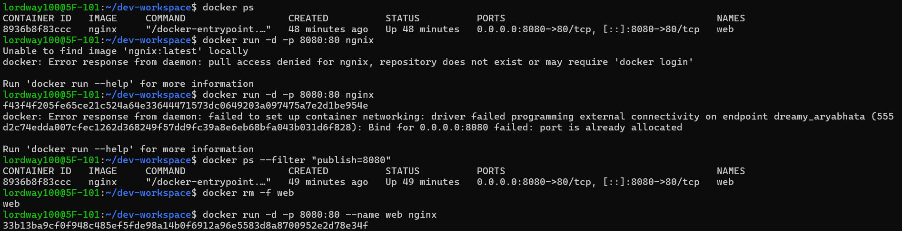

### 볼륨 마운트

#### 볼륨이란?
**Docker가 관리하는 호스트의 폴더 하나를 컨테이너 안의 특정 폴더에 연결(마운트)해 둔 것**이다.

- **실체는 그냥 폴더다.** `docker volume create mydata`를 하면 호스트에 `/var/lib/docker/volumes/mydata/_data` 폴더가 만들어진다. 실제 위치는 `docker volume inspect mydata`의 `Mountpoint`에서 확인할 수 있다.
- **마운트는 연결이다.** `-v mydata:/data`는 컨테이너 안의 `/data`를 바깥의 `mydata` 폴더와 연결한다. 컨테이너가 `/data/test.txt`에 쓰면 파일은 실제로 바깥 폴더에 저장된다. USB를 꽂는 것과 비슷하게, 컨테이너에게는 `/data`가 자기 폴더처럼 보이지만 실제로는 바깥 저장소다.
- **그래서 컨테이너를 지워도 데이터가 남는다.** 컨테이너를 지우면 컨테이너 내부(쓰기 레이어)의 파일만 사라지고, `/data`의 내용은 처음부터 바깥 폴더에 있었으므로 그대로 유지된다. 다음 컨테이너가 같은 볼륨을 연결하면 다시 볼 수 있다.

```
컨테이너 A  /data ─┐
                    ├──▶  mydata  (/var/lib/docker/volumes/mydata/_data)
컨테이너 B  /data ─┘       컨테이너를 지워도 남음
```

#### 볼륨 vs 바인드 마운트
둘 다 **"바깥 폴더를 컨테이너에 연결"하는 같은 원리**이며, 차이는 그 바깥 폴더가 어디에 있고 누가 관리하느냐이다.

| 구분 | 명령 예 | 바깥 폴더 위치 | 관리 주체 | 주 용도 |
|------|---------|----------------|-----------|---------|
| 네임드 볼륨 | `-v mydata:/data` | `/var/lib/docker/volumes/mydata/_data` | Docker | DB 데이터 등 보존용 |
| 바인드 마운트 | `-v $(pwd)/bind-test:/app` | 내가 지정한 폴더 | 사용자 | 소스 코드 개발, 파일 공유 |

`-v` 왼쪽이 **이름**(`mydata`)이면 네임드 볼륨, **경로**(`/`나 `$(pwd)`로 시작)이면 바인드 마운트다. 포트 매핑(`-p 8080:80`)과 마찬가지로 **왼쪽이 바깥(호스트), 오른쪽이 컨테이너 안**이다.

#### 기본 명령 예시

```bash
# 바인드 마운트: 호스트의 현재 폴더를 컨테이너 /app에 연결
docker run -it -v $(pwd):/app my-ubuntu

# 네임드 볼륨: Docker가 관리하는 저장소 사용
docker volume create mydata
docker run --rm -v mydata:/data ubuntu bash -c "echo hello > /data/test.txt"
docker run --rm -v mydata:/data ubuntu cat /data/test.txt   # 첫 컨테이너가 삭제돼도 hello 출력
```

#### 데이터 지속성 검증
첫 번째 컨테이너는 `/data/test.txt`에 `hello`를 쓰고 `--rm` 옵션으로 **종료와 동시에 삭제**되었다. 완전히 새로 만든 두 번째 컨테이너에서 같은 볼륨을 연결해 파일을 읽자 `hello`가 출력되었다. 데이터가 컨테이너가 아닌 볼륨에 저장되어 컨테이너 삭제 후에도 유지됨을 확인했다.

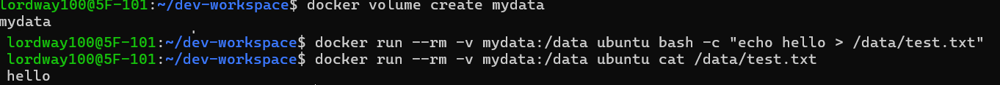

#### 경로 선택 기준과 재현성
- **컨테이너 경로는 항상 절대 경로** (`/app`, `/data`). Dockerfile의 `WORKDIR /app`과 맞춰 둔다.
- **호스트 경로도 절대 경로여야 한다.** `-v ./src:/app`처럼 상대 경로를 쓰면 실행 위치에 따라 결과가 달라지므로, `$(pwd)`로 현재 위치를 절대 경로로 바꿔 쓰고 항상 저장소 루트에서 실행한다.
- `/home/lordway100/...`처럼 특정 사용자 경로를 하드코딩하면 다른 PC에서 재현되지 않는다.
- WSL에서는 Windows 경로(`/mnt/c/...`)보다 Linux 경로(`~/...`)가 파일 I/O가 훨씬 빠르고 권한 문제가 적다.

#### 데이터 손실 방지

| 방식 | 저장 위치 | 장점 | 적합한 용도 |
|------|-----------|------|-------------|
| 컨테이너 내부 | 쓰기 레이어 | 간단 | 임시 데이터 (삭제 시 사라짐) |
| 바인드 마운트 | 호스트 폴더 | 호스트에서 바로 편집 가능 | 소스 코드 개발 |
| 네임드 볼륨 | Docker 관리 영역 | 경로·권한 문제 적음, 컨테이너 간 공유 | DB 데이터 등 |

볼륨도 `docker volume rm`이나 디스크 손상 시 사라지므로 중요한 데이터는 백업한다.

```bash
docker run --rm -v mydata:/data -v $(pwd):/backup ubuntu \
  tar czf /backup/mydata-backup.tar.gz -C /data .
```

### 환경 변수
`-e KEY=VALUE` 옵션이나 Dockerfile의 `ENV`로 설정한다. 비밀번호·설정값을 이미지에 하드코딩하지 않고 실행 시점에 주입할 수 있다.

```bash
docker run -e APP_ENV=dev my-ubuntu env
```

## 5. 트러블슈팅 사례

### WSL 배포판 import 실패 (`Wsl/ERROR_PATH_NOT_FOUND`)

**현상**
기존 Ubuntu 백업(`D:\ubuntu-backup.tar`)을 새 배포판으로 가져오려 했으나 실패했다.

```powershell
wsl --import Ubuntu C:\WSL\Ubuntu D:\ubuntu-backup.tar
# 지정된 경로를 찾을 수 없습니다.
# 오류 코드: Wsl/ERROR_PATH_NOT_FOUND
```

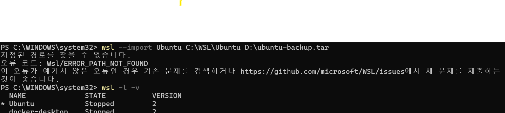

**가설**
1. `Ubuntu`라는 이름의 배포판이 이미 등록되어 있어 충돌한다.
2. 백업 파일 `D:\ubuntu-backup.tar` 경로가 틀렸다.
3. 설치 위치 폴더 `C:\WSL\Ubuntu2`가 존재하지 않는다.

**확인**
- `wsl -l -v` → `Ubuntu`가 이미 등록되어 있음 → 이름을 `Ubuntu2`로 바꿈.
- 이름을 바꿔도 같은 에러 발생 → 가설 1은 이 에러의 원인이 아님.
- `Test-Path D:\ubuntu-backup.tar` → `True` → 가설 2 기각.
- 남은 원인은 설치 폴더 부재.

**조치**
```powershell
mkdir C:\WSL\Ubuntu2
wsl --import Ubuntu2 C:\WSL\Ubuntu2 D:\ubuntu-backup.tar
# 작업을 완료했습니다.
```

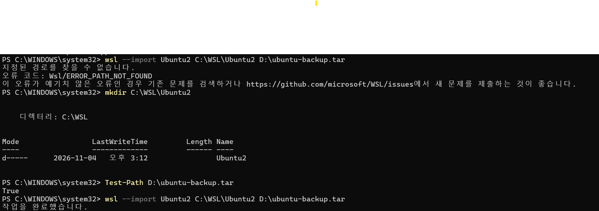

**결론**
`wsl --import`는 설치 위치 폴더를 자동으로 만들지 않는다. 대상 폴더를 먼저 만들고, 기존 배포판과 겹치지 않는 이름을 써야 한다. 에러 메시지만으로는 어느 경로가 없는지 알 수 없으므로 `Test-Path`로 경로를 하나씩 확인하는 것이 빨랐다.
